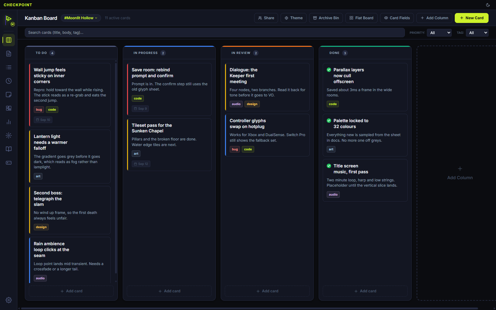
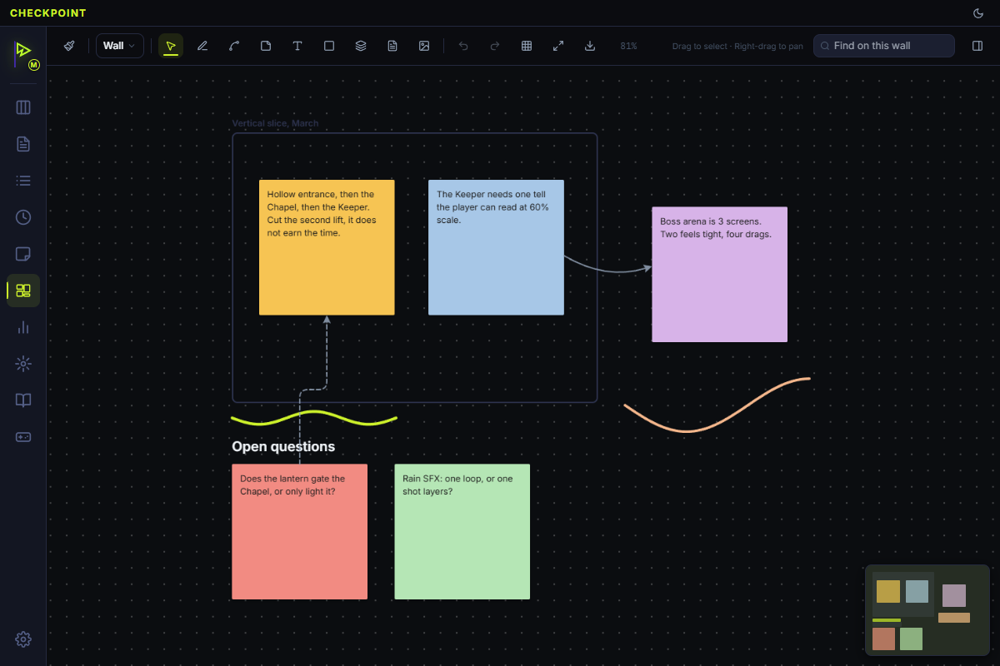
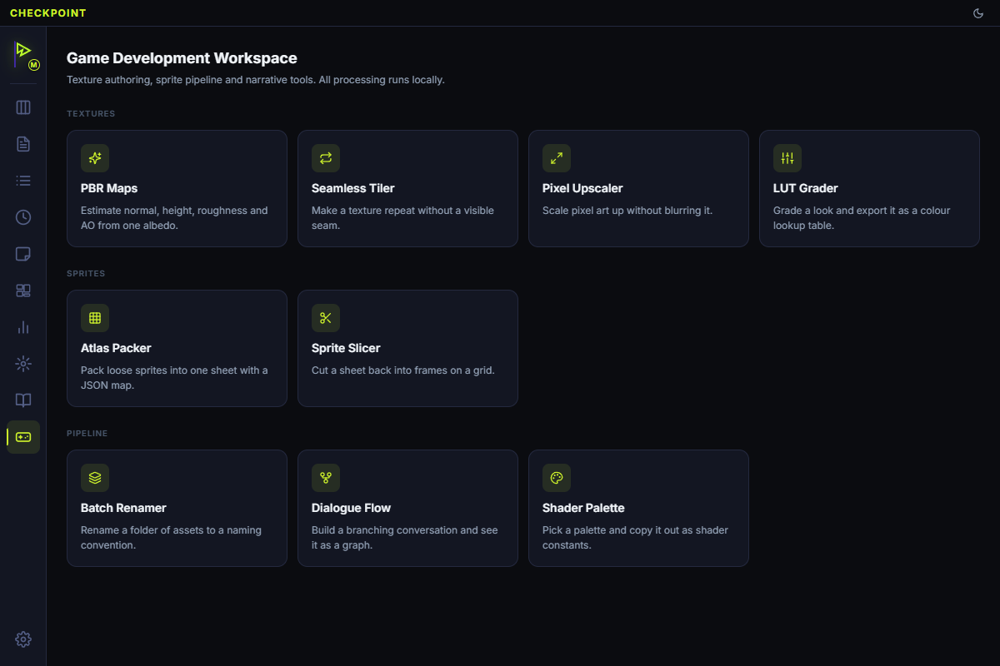
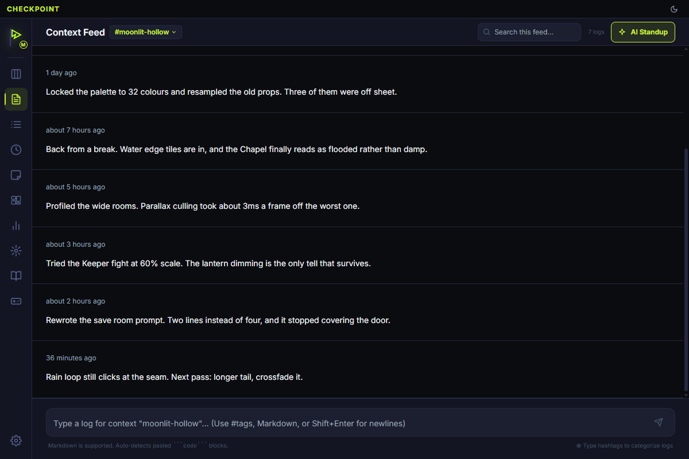
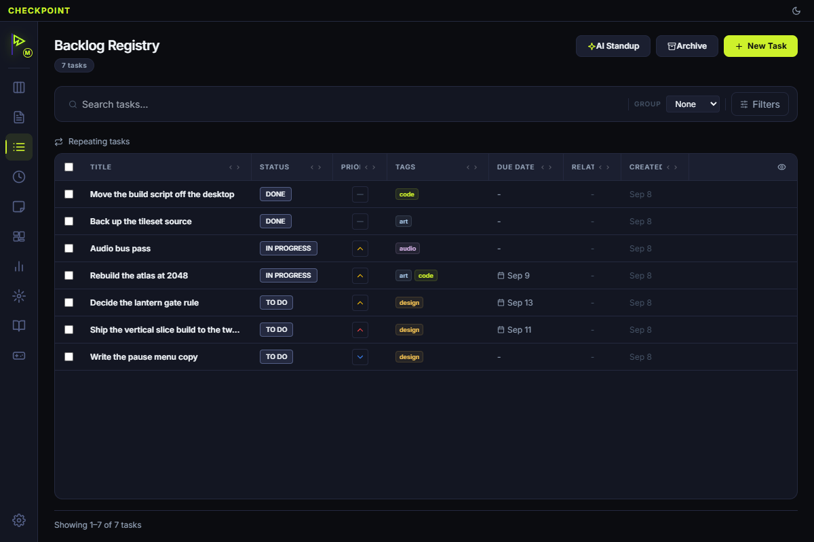
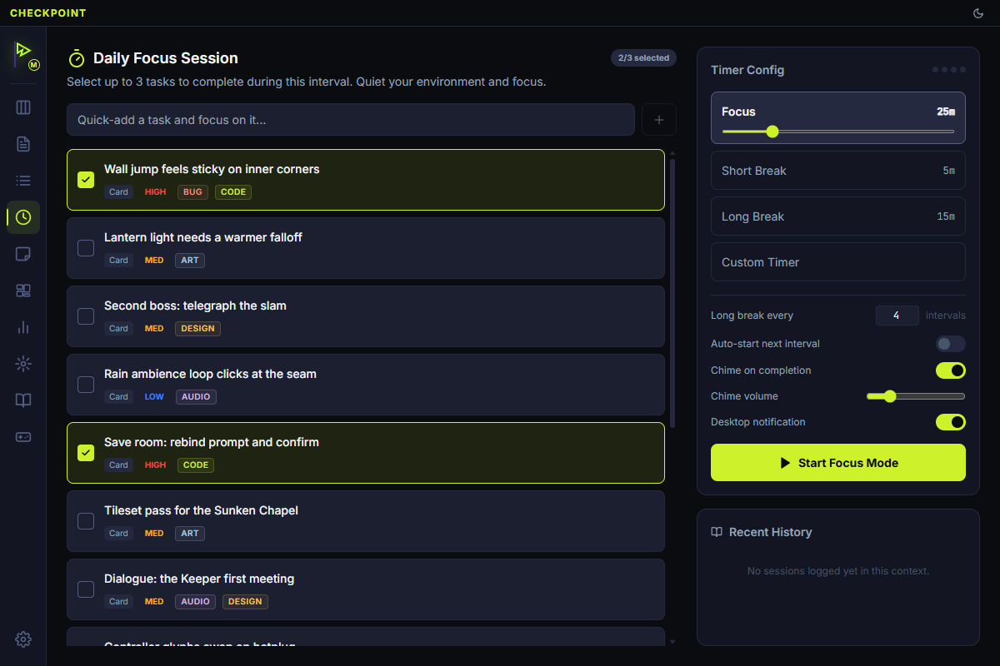

# Checkpoint

A local-first desktop workspace for keeping track of what you're doing.

I built this because I got tired of juggling many different apps during a game
dev session. A board in one, notes in another, a scratchpad in a third, some
texture utility in a fourth, a browser tab for the palette I picked last week.
Checkpoint is all of that in one window, on my machine, with no account.

It's a personal tool that got big enough to share. If it suits how you work,
take it.

## Screenshots



| The Wall | Game dev tools |
| --- | --- |
|  |  |

| The daily log | The backlog | The focus timer |
| --- | --- | --- |
|  |  |  |

The workspace in these is made up, so nothing in them is anyone's real data.

## What's in it

**Getting things down.** A daily log, a kanban board, a structured backlog, and
a pomodoro timer. Notes are plain Markdown files with `[[wiki links]]`, so
they're readable without Checkpoint and they work with Obsidian.

**The Wall.** A freeform canvas. Drop cards, notes, images and text anywhere,
draw on it, connect things with arrows. It's where I think before anything is
organised enough for a board.

**Game dev helpers.** Batch renaming, a dialogue tree editor, palette
extraction, PBR map generation, seamless texture tiling, a sprite atlas packer,
a slicer, LUT export and a pixel-art upscaler. None of it replaces a real DCC
tool; all of it saves a round trip.

**The odds and ends.** Clipboard history, a quick-capture overlay on
`Ctrl+Shift+Space`, PDF cheatsheets, and time analytics if you want them.

**AI, if you want it.** Bring your own endpoint: Ollama on localhost, or
anything OpenAI-compatible. There's a single switch in settings that removes
every AI feature from the interface if you'd rather not have it.

Everything runs on your machine. No account, no telemetry, nothing is uploaded.

## Installing

Grab the installer from
[Releases](https://github.com/KDim67/checkpoint-app/releases).

Run it and it installs itself, no wizard. It goes in your user folder, so
Windows won't ask for admin rights, and it opens when it's done.

It isn't code-signed, so SmartScreen will warn you the first time. More info →
Run anyway.

Checkpoint updates itself quietly in the background from that same Releases
page, and swaps the new version in the next time you close it, or straight
away if you click Restart to update in the title bar. What changed in each
release is under Settings, About, and shows once after an update.

## Building it yourself

You'll need Node 24+ and Git. The test harness uses `node:sqlite`, which is
why the bar is that high.

```bash
git clone https://github.com/KDim67/checkpoint-app.git
cd checkpoint-app
npm install
npm run dev
```

Other scripts:

```bash
npm run verify         # typecheck, lint, tests, build. Run this before a PR
npm test               # tests on their own
npm run build          # compile without packaging
npm run check:sandbox  # try to break out of the plugin sandbox in a real Electron
npm run package        # verify, the sandbox check, then an installer into dist/
```

The first `npm install` takes a few minutes: it downloads Electron itself and
rebuilds `better-sqlite3`, a native module, against it.

Both of those happen in `postinstall` rather than being left to npm. npm 11
blocks a dependency's own install scripts until you approve them, which meant a
fresh clone finished with no Electron binary and a `npm run dev` that could not
start. Running it ourselves sidesteps the question, and it costs nothing when
the binary is already there.

## Things worth knowing

**Your data is in two places.** The database in `%APPDATA%\checkpoint-app\`,
and your notes, media and plugins in `%USERPROFILE%\.config\checkpoint\`. On
macOS and Linux both live under `~/.config/`. Uninstalling leaves all of it
alone on purpose, so reinstalling picks up where you left off. Delete those two
folders by hand if you want it gone.

The database folder is called `checkpoint-app` rather than `Checkpoint` because
Electron names it after the package. It looks like a mistake and isn't one to
fix: renaming it would point an updated app at an empty folder.

**Backups happen on their own.** Timestamped, compressed, rolling. Settings →
Backups to restore one. A copy of the current database is taken just before any
restore, so a restore you didn't mean is undoable.

**Keyboard.** `Ctrl+1` through `Ctrl+0` walk down the sidebar, `Ctrl+-` for the
game dev tools, `Ctrl+L` toggles the AI panel, `Ctrl+,` opens settings. All
rebindable in Settings → Shortcuts.

**Clipboard history is off until you turn it on.** When it's on it records
what you copy into the database in plain text. It skips anything the copying
app marks as private, the way KeePassXC, 1Password and Bitwarden's desktop app
mark passwords for Windows' own clipboard history, and it skips text that looks
like a credential. Browser extensions don't mark their copies, so for those
it's a guess and not a guarantee. Deleting a copy deletes it on the computers
you sync with too.

## Setting things up

### AI

Settings → AI. Point it at any OpenAI-compatible endpoint.

For Ollama, use `http://localhost:11434/v1` and leave the key blank. For a
cloud provider, paste the base URL and your key. Keys are encrypted with the OS
keychain, never sync between machines, and never go back to the screen once
saved. Pointing a connection at a different site forgets its key, so a key is
only ever sent where you first gave it.

Don't want any of it? Settings → Features → AI Assistant, one switch, and every
AI control disappears.

### Syncing between machines

Two ways, both direct, neither goes through a server of mine.

**Same network:** one machine hosts, the other joins with a six-digit pairing
code. Fastest and needs no setup. The code never crosses the network: the two
machines turn it into a key with CPace, so someone listening can't work it out,
and everything after is encrypted. Both machines need this version or later.
This is also the only way the calendars you subscribe to travel, links and all;
over the internet they stay on each machine.

**Over the internet:** peer-to-peer via WebRTC, end-to-end encrypted, with a
code like K7QD-482913. The first four characters name a public room on ntfy.sh
where the two machines meet; the six digits never leave either one. They pair
with CPace through that room, so whoever runs or watches it can neither learn
the digits nor step in between, and after five wrong tries the code stops
working. Sharing a board live works the same way. Both machines need this
version or later. If both machines are behind a strict NAT (mobile tethering,
some office networks) they can't find each other directly and you'll need a
relay. There's a field for your own TURN server in Settings → P2P Network Sync;
Checkpoint doesn't ship one.

### Connections

Settings → Connections brings work from services you already use onto your
boards. Each connection uses a personal key you make in that service; nothing
goes through a server, and nothing is registered on your behalf.

**GitHub:** open issues in a workspace's repository become cards, either the
ones assigned to you or all of them. Make a fine-grained key on GitHub with
*Issues: Read and write* for the repositories you want, and paste it in. A
workspace follows the repository its folder's `origin` remote points at, or one
you type as `owner/repo`.

- Closing or reopening an issue on GitHub moves its card; moving a card to Done
  closes the issue, and moving it out reopens it. A key that can only read
  leaves GitHub's state standing, and the card says so.
- GitHub owns the title, description and milestone date, so change those
  there. Your columns, priority, tags and checklist stay yours.
- Deleting a card stops following its issue for good. An issue that's no
  longer yours keeps its card, marked as no longer on GitHub.
- Checkpoint checks every five minutes and when you come back to the window,
  and tells you a week before the key expires.

The key is encrypted on that computer, never shown again and never synced:
paste it on each computer that should talk to GitHub. The cards themselves sync
like any others, and the same issue becomes the same card everywhere.

**Todoist:** each workspace follows one of your Todoist projects, and its open
tasks become cards. Copy your API token from Todoist (Settings, Integrations,
Developer), paste it in, and pick a project for each workspace.

- Done goes both ways: moving a card to Done completes the task, and
  completing or reopening it in Todoist moves the card.
- So do the title, the description and the date. If both sides change before
  Checkpoint checks, Todoist's version is kept and the card says so.
- A repeating task comes back on its next date when you finish it, as it does
  in Todoist. Its date stays Todoist's, so change the pattern there.
- A task deleted in Todoist, or moved to a project no workspace follows, keeps
  its card, marked as no longer in Todoist. Moving it to a project another
  workspace follows moves the card too. Deleting a card stops following its
  task; nothing is ever deleted in Todoist.

The token is kept the same way as GitHub's key: encrypted, never shown again,
and never synced.

**Linear:** each workspace follows one of your teams, and its open issues
become cards, either the ones assigned to you or all of them. Make a personal
API key in Linear (Settings, Security & access), paste it in, and pick a team
for each workspace.

- Moving a card to Done moves the issue to its team's Done state, and moving it
  out sends it back to Todo. A completed or canceled issue moves its card to
  Done, and the badge shows Linear's own name for the state.
- The title, the description and the due date go both ways, with Linear's
  version kept if both sides change before a check. Linear's due dates are
  whole days, so a time set on the card becomes that day.
- A key that can only read leaves Linear's state standing, and the card says so.
- An issue deleted, no longer yours, or moved to a team no workspace follows
  keeps its card, marked as no longer in Linear. Moving it to a team another
  workspace follows moves the card too.

**Jira Cloud:** each workspace follows one of your projects, and its open
issues become cards, either the ones assigned to you or all of them. Make an
API token for your Atlassian account, then give Checkpoint your Jira address
(`yourname.atlassian.net`), the email you sign in with, and the token.

- Moving a card to Done runs your workflow's transition to Done, and moving it
  out runs one back to To Do. If the workflow has no way there from where the
  issue is, the card goes back and says why.
- The title and the due date go both ways. The description comes from Jira and
  is read-only on the card: Jira keeps it in its own format, so change it there.
- Atlassian tokens expire after at most a year, and Jira doesn't say when in
  advance; when one stops working, Checkpoint tells you.
- Jira never reports deleted issues, so once an hour Checkpoint asks for every
  issue that has a card, and marks the ones it no longer finds.
- Jira Server and Data Center aren't supported.

**Notion:** each workspace follows one of your databases, and its pages that
aren't done become cards. Make an internal integration in Notion and copy its
secret, then add the integration to each database you want under the page's
••• menu, Connections; Notion only lets an integration see what it's added to.

- Done is the database's first Status column, done when its option is in the
  Complete group, or else its first checkbox. The date is its first Date column.
  When a database has more than one of either, its row in Settings lets you
  pick.
- Moving a card to Done sets the status to the first Complete option, or ticks
  the box; moving it out sets the first To-do option, or unticks it.
- The title and the date go both ways, times included. The card's description
  stays its own.
- Once an hour Checkpoint looks in Notion's trash and marks cards whose pages
  are there. A page moved to a database another workspace follows moves its
  card; one moved to a database nobody follows isn't noticed.

**Obsidian:** no account and no key. Each workspace follows a folder on this
computer, a whole vault or a folder inside one, and the unticked tasks in its
notes (`- [ ] Like this`) become cards. Checkpoint looks for changed notes every
30 seconds.

This one writes to your notes, so here is exactly what it changes:

- When a task first comes in, a short block id goes on the end of its line
  (`^cp-4f2a9c1e`). It's how the card keeps following the task through edits
  and moves between notes, and Obsidian hides it in reading view. A task that
  already has a block id keeps it.
- Moving a card to Done ticks the box, and moving it out unticks it. Changing
  the card's title or date rewrites that task's line, keeping its other fields;
  dates are written the way the line already has them (`📅 2026-10-12`, or
  Dataview's `[due:: 2026-10-12]`). Obsidian's dates are whole days.
- Nothing else in a note is touched, nothing outside the chosen folder is ever
  written, and a note that changed since Checkpoint read it is left until the
  next look.
- A repeating task (🔁) has to be ticked in Obsidian, so the Tasks plugin can
  make the next one; its date stays Obsidian's too.
- The folder is remembered on this computer only. Checkpoint's one-off vault
  import, in the Notes sidebar, still never writes to your vault.

### Webhooks

There's a small HTTP server for pushing things in from scripts and CI. It needs
a token, which you'll find in Settings → Features → Local Webhook Gateway.

```bash
curl -X POST http://localhost:9988/api/v1/log \
  -H "Authorization: Bearer <your-token>" \
  -H "Content-Type: application/json" \
  -d '{"context":"my-game","title":"Build passed","body":"2m 14s"}'
```

`/api/v1/task` does the same thing but creates a backlog task.

The token isn't optional. The server listens on localhost, and any page in any
browser you have open can reach localhost, so without it a website could write
to your database.

### Importing from elsewhere

Trello and Todoist boards import as workspaces (Settings → Workspaces →
Import). An Obsidian vault imports as notes, from the button in the Notes
sidebar. Nothing is silently dropped: anything that can't come across is
reported back to you.

### Plugins and theming

Drop a `.js` file into `.config/checkpoint/plugins/` and turn it on in Settings →
Extensions. Each plugin runs in its own sandboxed process with no Node, no file
access and no network of its own. It can only do what it asks for in its
metadata, and you approve that list when you turn it on, on that computer only:

| Permission | What it allows |
| --- | --- |
| `read` | See cards, tasks and log entries in the workspaces you pick, and hear when they're created, finished or due |
| `write` | Create and change them in those workspaces; never delete |
| `notify` | Show notifications; quiet hours still apply |
| `hosts` | Send HTTPS requests to the sites listed, and nowhere else |

```js
module.exports = {
  metadata: {
    name: "Hello",
    version: "1.0.0",
    permissions: ["read", "notify"]
  },
  onLoad(api) {
    api.events.on("item:completed", ({ item }) => api.notify("Done", item.title))
  }
}
```

Every `api` call returns a promise. A plugin that changes its file to ask for
more is stopped until you approve it again. Settings → Extensions installs four
examples that between them use the whole API, and [docs/plugins.md](docs/plugins.md)
is the full reference.

Theming is CSS custom properties, live-editable in Settings → Appearance, or
edit `.config/checkpoint/theme.css` directly.

## Contributing

Issues and pull requests welcome.

Run `npm run verify` before opening a PR: it typechecks, lints, runs the tests
and builds. All four have to pass.

A note on dependencies, because it's caught people out: only packages the
**main process** loads at runtime belong in `dependencies`. Everything the
renderer uses is a devDependency, because Vite bundles it into `out/renderer`
during the build. A renderer library listed under `dependencies` ships a second
copy of itself inside the installer, which cost 105 MB before anyone noticed.
If you add a package, build and check whether it appears in `out/main`.

## Built with

Electron, React, TypeScript, SQLite via `better-sqlite3`, Vite, Zustand,
Three.js for the texture previews, and Mermaid for diagrams in notes.

## Licence

MIT. See [LICENSE](LICENSE).

Checkpoint bundles a lot of open-source packages, all of them permissive. Their
notices ship with the app in `resources/THIRD-PARTY-LICENSES.txt`, generated
from the dependency tree:

```bash
node scripts/third-party-licences.mjs
```

Re-run it when dependencies change.
